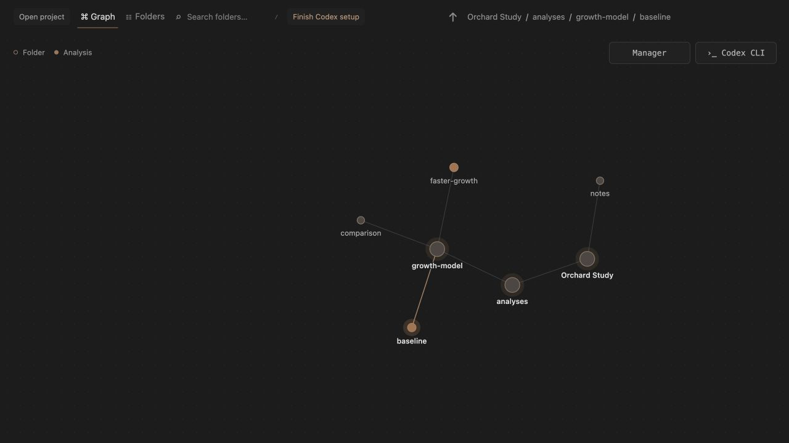
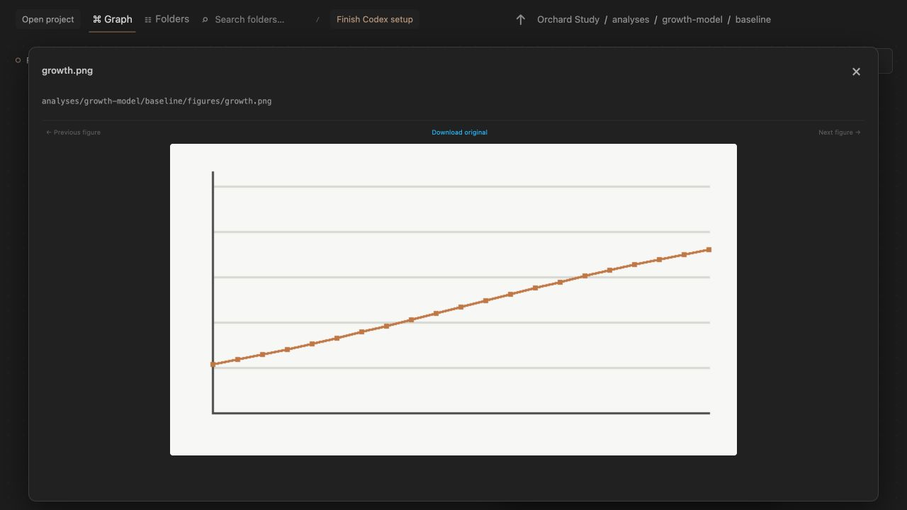

# A short tour of Research Map

Research Map is for researchers who want to understand their project through its folders, results and conversations. It combines an interactive folder graph, resource inspection, file previews and optional Codex CLI conversations.

The example below uses only the bundled **Orchard Study**. Its measurements and results are synthetic.

[Watch the 52-second video](../README.md#52-second-demo) · [Video transcript](DEMO_VIDEO.md)

## 1. Open a project and see its structure

Start the app and choose **Explore fictional demo**. Expand **analyses → growth-model** to see three peer folders: **baseline**, **faster-growth** and **comparison**.



Click nodes to expand or collapse branches. Drag to rearrange the graph, pan or zoom, and use **Folders** to browse the same structure as a directory tree. Folder and graph expansion share their navigation state.

Existing project folders stay where they are. The app stores its generated index and conversation metadata in the project's hidden `.research-map/` directory.

## 2. Inspect an analysis rather than hunting across folders

Right-click **baseline**, choose **Inspect**, and explore its resources. The demo analysis package contains:

```text
baseline/
├── code/
│   └── model.py
├── data/
│   └── growth.csv
├── figures/
│   └── growth.png
├── analysis_report.json
└── metadata.json
```

Navigation nodes help you move through the project. Analysis nodes expose the result's resources. Recorded code references are labelled by their evidence; finding a script does not by itself prove that it generated a figure.

## 3. Open the actual files

Inside **Inspect → Figures**, expand the figures folder and open `growth.png`.



The demo figure plots simulated plant height against day. Inspect the code or CSV to see the calculation and values. Supported text files open in a read-only viewer; image files open in an image preview. When an inspection contains several images, use **Previous/Next** or the left/right arrow keys to browse them.

## 4. Keep AI work attached to its research context

With Codex CLI installed and signed in, use the CLI window for project-wide work or start a conversation bound to a selected analysis. Right-click a node and choose **Codex conversations…** to find its registered conversations. Clicking a conversation resumes its native session when available.

The conversation's right-click menu also offers **Continue in new session** and **Recovery & history**. Recovery uses recorded summaries, checkpoints and events; a new session reads that context instead of pretending to be the original chat.

The demo ships no fabricated conversations. You can try a real one using your own account, for example:

> Explain how the baseline growth model differs from faster-growth. Read the scripts and reports; do not change files or run analysis.

The project Manager provides a shared view of registered work. It tracks the app's registered/imported sessions rather than every conversation on your computer.

## 5. Give new results a reproducible home

For new analysis work, the managed workflow reviews where the result belongs before creating a package or executing the analysis:

- A parameter variant usually sits beside its peer.
- A narrower investigation may belong below its parent analysis.
- A comparison belongs under a suitable shared parent or comparison collection.

Each result can keep its code snapshot, small outputs, figures, metadata and description together. Large input data can remain referenced in place. Newly created analysis folders appear through the inventory watcher.

See [the workflow reference](../RESEARCH_WORKFLOW.md) for placement review, hooks, checkpoints and recovery. Codex setup and hook trust remain explicit steps in the CLI.

## Try it

```sh
git clone https://github.com/JUDEKEPA/research-map.git
cd research-map
npm ci
python3 launcher.py --port 8767
```

Open `http://127.0.0.1:8767` and click **Explore fictional demo**. You can inspect the complete bundled example without an AI account.
